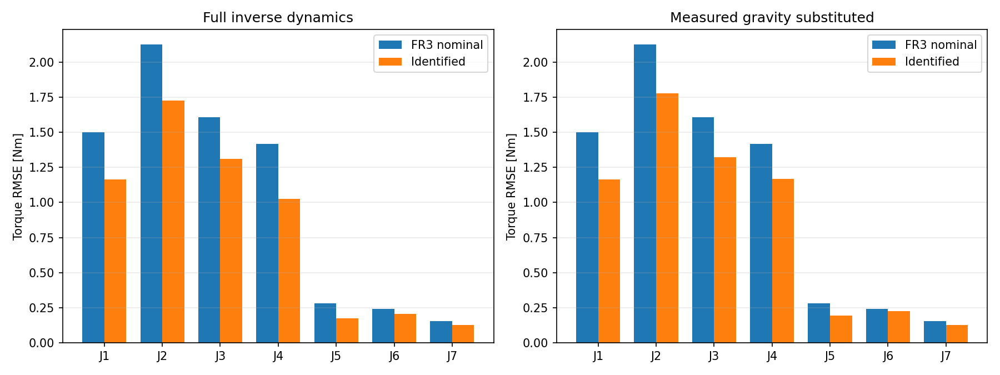
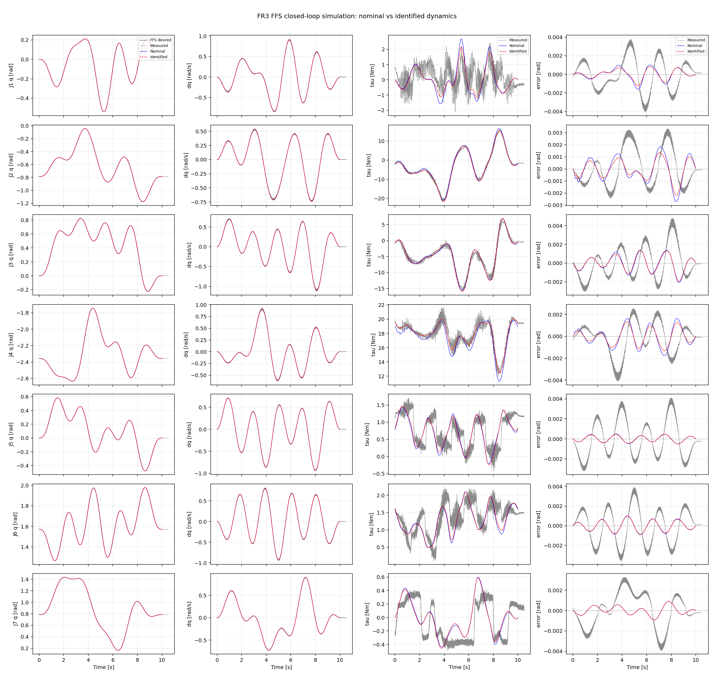
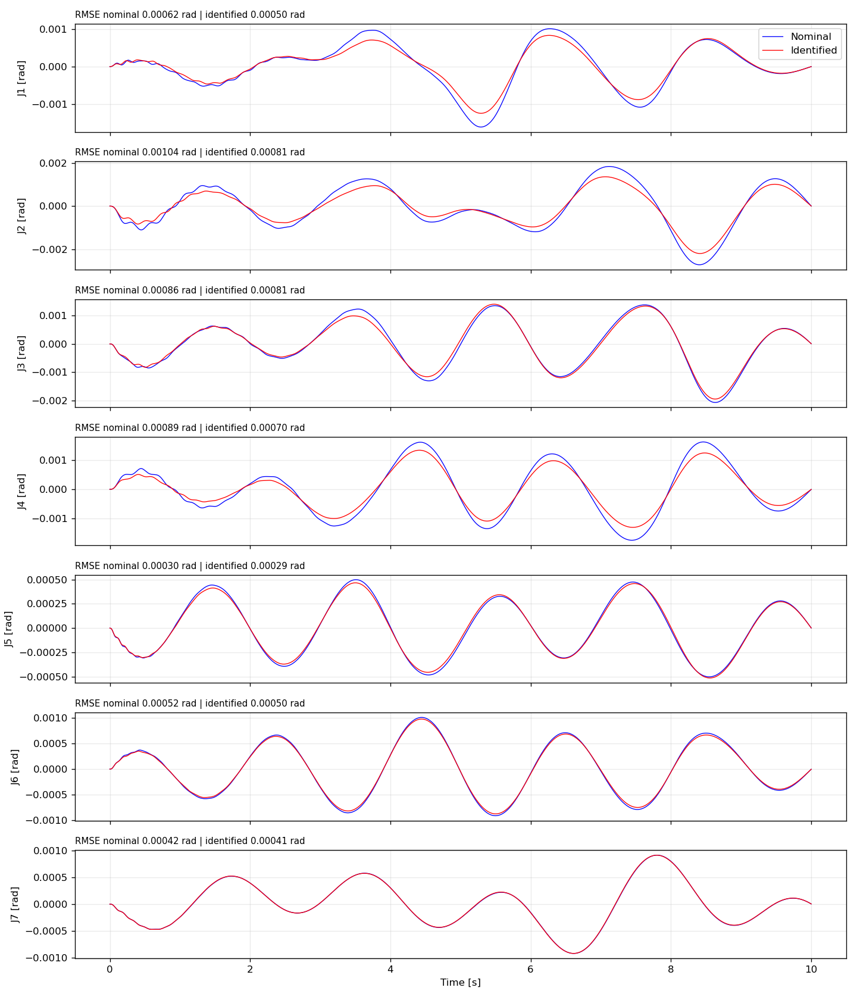

# FR3 七连杆离线流程运行报告

运行模式：`full`。
本次使用包内完整 train/test 数据。

训练样本 102881；设计矩阵秩 57/84，零空间维数 27。
求解器：cvxpy SDP (CLARABEL: optimal)；IRLS 迭代 25 次，收敛标记 True。

| 测试评估 | 名义总体 RMSE / Nm | 辨识总体 RMSE / Nm |
|---|---:|---:|
| 完整逆动力学 | 1.283496 | 1.014476 |
| 替换重力项 | 1.283496 | 1.051042 |

逐关节结果：[test_metrics.json](evaluation/test_metrics.json)。
参数和物理可行性：[fit_report.json](identification/fit_report.json)。

仿真是同一控制律在两个模型上的敏感性对比。跟踪误差减小本身不证明模型更接近真机；请同时查看测试集力矩预测和 simulation_metrics.json 中与实测数据的误差。

固定电机/减速器 armature 不参与七连杆参数估计。与历史参考图的设置差别见 docs/MODEL_EXPORT_AND_SIMULATION.md。

辨识结果中有连杆质量明显偏离名义先验。它们是当前模型与物理约束下的可行代表解，不能当作逐连杆称重结果：

- fr3_link2: fitted mass is 3.24 times its nominal prior. This is a physically feasible parameter representative, not an independently measured link mass.
- fr3_link3: fitted mass is 3.61 times its nominal prior. This is a physically feasible parameter representative, not an independently measured link mass.
- fr3_link4: fitted mass is 2.02 times its nominal prior. This is a physically feasible parameter representative, not an independently measured link mass.
- fr3_link7: fitted mass is 0.0935 times its nominal prior. This is a physically feasible parameter representative, not an independently measured link mass.
